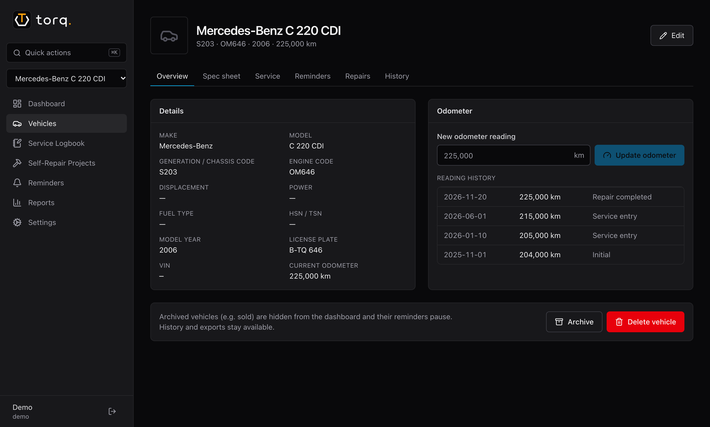
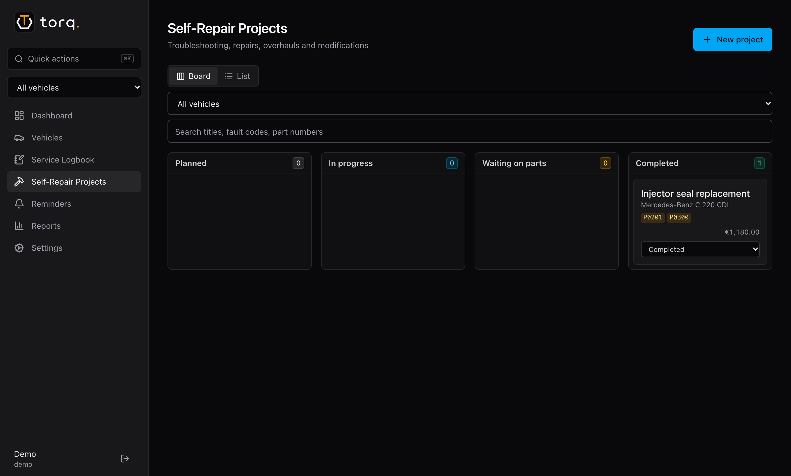

<div align="center">

<picture>
  <source media="(prefers-color-scheme: dark)" srcset="docs/assets/torq-logo-w-title-dark.svg">
  
</picture>

**The maintenance logbook and repair tracker for people who work on their own cars.**

Self-hosted · one small Docker container · your data stays on your server

[](https://github.com/app-torq/torq/actions/workflows/ci.yml)
[](https://github.com/app-torq/torq/releases)
[](https://github.com/app-torq/torq/pkgs/container/torq)
[](go.mod)
[](LICENSE)
[](#)
[](https://demo.torq-app.tech)

[Quick start](#quick-start) · [Features](#features) · [Configuration](#configuration) · [Wiki](https://github.com/app-torq/torq/wiki) · [Demo](https://demo.torq-app.tech)

</div>

<p align="center">
  
  
</p>

> [!NOTE]
> A public demo runs at **[demo.torq-app.tech](https://demo.torq-app.tech)**
> 
> The Login is Username: `demo`, Password: `password123`

## Features

- 🛢️ **Service logbook**: oil changes, fluids, filters, brakes. Each entry records brand, spec, quantity, part numbers and cost, and resets its reminder.
- 🔧 **Self-repair projects**: a board from *Planned* to *Completed*, with OBD2 fault codes, root cause, procedure notes, torque specs, a parts list and photos.
- ⏰ **Reminders** by kilometres, by time or whichever comes first, re-checked with every odometer update.
- 🚗 **Vehicle catalog that works offline**: enter the HSN/TSN from the German registration certificate, or pick make → model → chassis code (W203, E46, Golf IV) → engine to fill in the technical data.
- 📋 **Spec sheet** with oil and fluid specs, capacities, lug torque and tyre pressure, filled in from the web on request, with a source link for every value.
- 🔔 **Notifications** via webhooks to Discord, ntfy, Gotify, Home Assistant or any JSON endpoint.
- 📊 **Reports**: costs per vehicle, service vs. repair, cost per km, a timeline and a printable history with JSON/CSV export.
- 🌍 English and German, metric units, multiple users per garage.

## Quick start

```bash
docker run -d --name torq -p 8080:8080 -v torq-data:/data -e TZ=Europe/Berlin \
  ghcr.io/app-torq/torq:latest
```

Open <http://localhost:8080> and create the administrator account.

> [!IMPORTANT]
> Create the administrator account right after the first start. Until it exists, anyone who can reach torq can create it.

Prefer Compose or building it yourself? `docker compose up -d` builds the image from this repository using [`docker-compose.yml`](docker-compose.yml).

> [!TIP]
> To run torq on a small VPS with automatic deployments on every push, HTTPS and your own domain via Cloudflare Tunnel, follow [`docs/deployment.md`](docs/deployment.md).

The image is a ~29 MB static binary on a distroless base. It runs as non-root, needs only the `/data` volume and typically uses well under 100 MB of RAM.

## Configuration

All settings are optional environment variables. The most common ones:

| Variable | Default | Purpose |
|---|---|---|
| `TZ` | `UTC` | Time zone for reminder dates and digests |
| `TORQ_BASE_URL` | *(empty)* | Public URL, e.g. `https://torq.example.com`. Enables links in notifications and, with https, `Secure` cookies (also set for any request that arrives over HTTPS) |
| `TORQ_TRUSTED_PROXIES` | *(empty)* | CIDRs of your reverse proxy, so login throttling sees real client IPs and `X-Forwarded-Proto` is trusted |
| `TORQ_MAX_UPLOAD_MB` | `25` | Per-file upload limit (JPEG, PNG, WebP, HEIC, PDF) |
| `TAVILY_API_KEY`, `GEMINI_API_KEY` | *(empty)* | Both together enable the optional spec-sheet auto-fill |

The full list, including logging, cookies, the Gemini model and catalog updates, is in the wiki under [Configuration](https://github.com/app-torq/torq/wiki/Configuration).

Apps and scripts use the same REST API as the web app. A mobile app is in development. [docs/api.md](docs/api.md) explains sign-in with tokens and the compatibility promise; the contract is [`openapi.yaml`](openapi.yaml).

> [!NOTE]
> The spec-sheet auto-fill is the only feature that sends data to third parties: the vehicle's make, model, chassis code, year, engine and HSN/TSN go to [Tavily](https://tavily.com) and Google Gemini. It is off unless both keys are set. Both services have free tiers. See [Spec sheet auto-fill](https://github.com/app-torq/torq/wiki/Spec-Sheet-Auto-Fill).

## Data and backups

Everything lives in the data directory (`/data` in the container): the SQLite database, uploaded photos and PDFs, and automatic copies taken before each schema upgrade.

> [!WARNING]
> Back up `/data` regularly. Copying it while torq is running can catch the database mid-write: stop the container first, or use the [online backup command](https://github.com/app-torq/torq/wiki/Data-and-Backups#backups) from the wiki.

Schema migrations only move forward and run automatically at startup. More in [Data and backups](https://github.com/app-torq/torq/wiki/Data-and-Backups).

## Documentation

The [wiki](https://github.com/app-torq/torq/wiki) covers installation, all settings, notifications and webhook payloads, the vehicle catalog, the spec-sheet auto-fill, backups, deployment and development.

## Vehicle data & licenses

The vehicle catalog ships with torq and lookups run offline. Admins can refresh it from its sources under **Settings → About & data sources** (disable with `TORQ_CATALOG_ONLINE_UPDATES=false`). The bundled data comes from:

- **Kraftfahrt-Bundesamt (KBA), FZ 6**: "Bestand an Kraftfahrzeugen und Kraftfahrzeuganhängern nach Herstellern und Typen", stand 1 January 2024, [kba.de](https://www.kba.de/DE/Statistik/Fahrzeuge/Bestand/ListeHerstellerTypSchluesselnummern/typschluesselnummern_node.html).
  © Kraftfahrt-Bundesamt, Flensburg. Datenquelle: Kraftfahrt-Bundesamt, FZ 6, 2026-10-31; [Datenlizenz Deutschland – Namensnennung – Version 2.0](https://www.govdata.de/dl-de/by-2-0) (dl-de/by-2-0); Daten geändert (data modified by torq).
- **vehicle-makes-models**: [github.com/gor3a/vehicle-makes-models](https://github.com/gor3a/vehicle-makes-models), `data/json/all.json` at commit `ee99776470a45214bf524cdfe22e5dbf4bd67f93`, compiled from publicly available information on [autoevolution.com](https://www.autoevolution.com). Licensed under the [Open Database License (ODbL) 1.0](https://opendatacommons.org/licenses/odbl/1-0/); changes were made.

The combined catalog (`internal/catalog/data/catalog_seed.json.gz`) is a derived database distributed under the ODbL 1.0 ([full text](internal/catalog/data/LICENSE-ODbL.txt)). Sources, retrieval dates and every transformation are documented in [`NOTICE.md`](internal/catalog/data/NOTICE.md). The same attributions appear in the app under **Settings → About & data sources**.

## Development

```bash
make setup   # go mod download + npm ci
make dev     # Go API on :8080 + Vite on :5173
make check   # vet, golangci-lint, sqlc diff, tsc, eslint, i18n check
make test    # go test + vitest
make e2e     # Playwright suite against bin/torq
```

Requirements: Go 1.26+, Node.js 22, golangci-lint v2, and sqlc (only after editing `internal/store/queries`). More in [Development](https://github.com/app-torq/torq/wiki/Development).

Contributions are welcome, from bug reports to corrections of the chassis-code table (`internal/catalog/catalogsync/chassis.txt`).

## License

The torq source code is licensed under the [MIT License](LICENSE). The bundled vehicle catalog is licensed separately under the ODbL 1.0 (see above).
