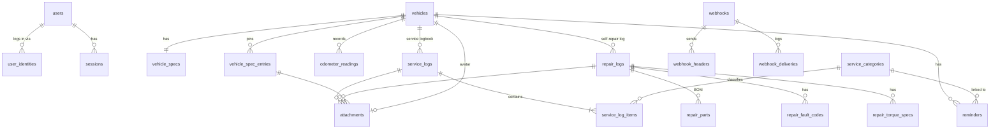
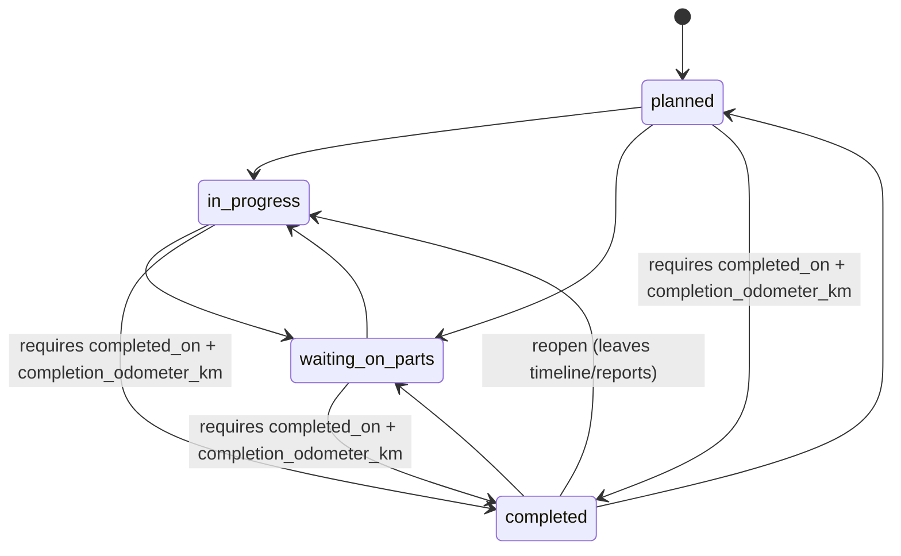
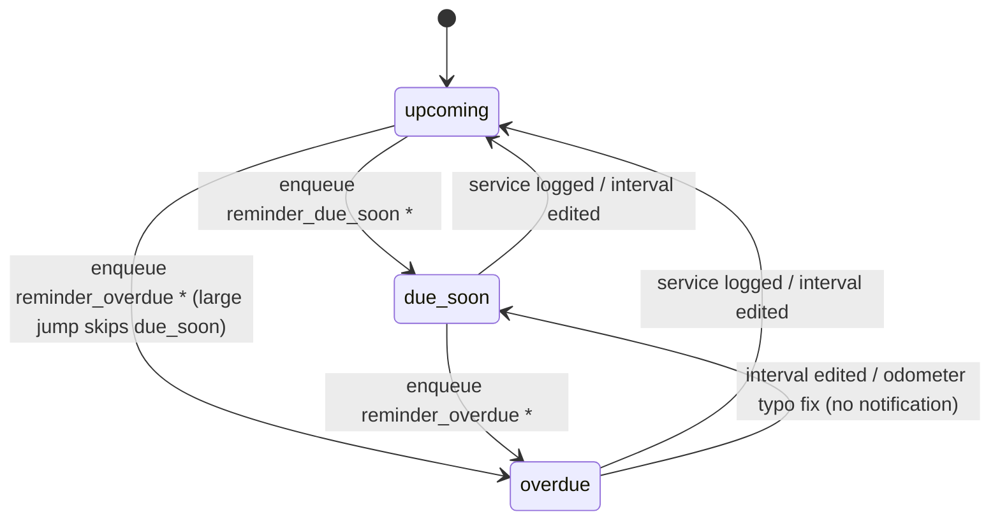
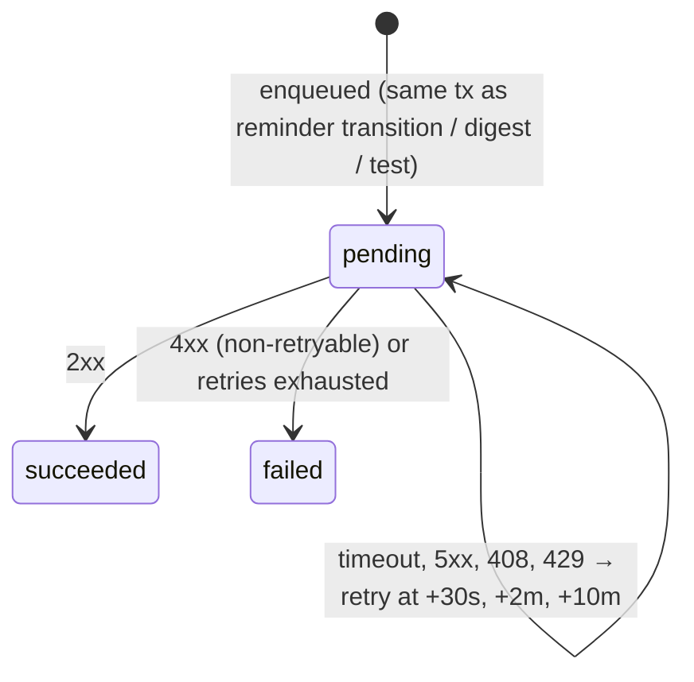

# Data Model: torq Core Platform

**Feature**: [spec.md](./spec.md) | **Plan**: [plan.md](./plan.md) | **Date**: 2026-10-30

SQLite with `foreign_keys=ON`. Conventions:

- `id INTEGER PRIMARY KEY` (rowid alias) on every table.
- Timestamps are `TEXT` RFC 3339 UTC (`created_at`, `updated_at`). Calendar dates are `TEXT` `YYYY-MM-DD`.
- Money is `INTEGER` cents. Odometer is `INTEGER` km. Capacities and fluid quantities are `INTEGER` mL.
  Torque (Nm) and pressure (bar) are `REAL`.
- Booleans are `INTEGER CHECK (x IN (0,1))`.
- Enums are `TEXT` with `CHECK (x IN (…))`.
- Free-text columns are `TEXT NOT NULL DEFAULT ''` unless absence carries meaning.
- `created_by INTEGER NULL REFERENCES users(id) ON DELETE SET NULL` is for attribution only (shared garage,
  see research R22).

**Constitution II**: the Service Logbook (`service_logs`, `service_log_items`) and the Self-Repair Log
(`repair_logs`, `repair_*`) are separate tables with no shared "event" table and no type discriminator. They
share only `vehicles`, `odometer_readings` and `attachments`, each through its own explicit nullable FK.



---

## 1. Identity & Access

### `users`
| Column | Type | Rules |
|---|---|---|
| id | INTEGER PK | Internal provider-agnostic ID; the only user key referenced by domain tables (Constitution IV) |
| username | TEXT NOT NULL UNIQUE COLLATE NOCASE | 3–32 chars, `[a-zA-Z0-9._-]` |
| display_name | TEXT NOT NULL | 1–64 chars |
| role | TEXT NOT NULL | `admin` \| `member` |
| locale | TEXT NOT NULL DEFAULT 'en' | `en` \| `de` |
| date_format | TEXT NOT NULL DEFAULT 'YYYY-MM-DD' | `DD.MM.YYYY` \| `YYYY-MM-DD` |
| number_format | TEXT NOT NULL DEFAULT 'point' | `point` (1,234.5) \| `comma` (1.234,5) |
| currency_code | TEXT NOT NULL DEFAULT 'EUR' | ISO 4217 (`EUR`, `USD`, `GBP`, `CHF`, …) |
| currency_symbol | TEXT NULL | Optional free-text override, ≤ 5 chars |
| disabled_at | TEXT NULL | Disabled users cannot log in. Their sessions are deleted when disabled |
| created_at, updated_at | TEXT NOT NULL | |

Invariants (enforced in the service layer inside one transaction): at least one enabled `admin` must
always exist. The last enabled admin cannot be deleted, disabled or demoted.

### `user_identities`
| Column | Type | Rules |
|---|---|---|
| id | INTEGER PK | |
| user_id | INTEGER NOT NULL FK → users ON DELETE CASCADE | |
| provider | TEXT NOT NULL | `local` now. Later `oidc:<name>` |
| subject | TEXT NOT NULL | `local`: lowercase username. OIDC: the `sub` claim |
| issuer | TEXT NULL | OIDC issuer URL. NULL for local |
| password_hash | TEXT NULL | argon2id PHC string. CHECK `(provider = 'local') = (password_hash IS NOT NULL)` |
| created_at, last_login_at | TEXT | |

`UNIQUE (provider, subject)`. A user has at most one `local` identity (partial unique index on `user_id`
where `provider='local'`). Renaming a user updates the local `subject` in the same transaction.

### `sessions`
| Column | Type | Rules |
|---|---|---|
| id | INTEGER PK | |
| user_id | INTEGER NOT NULL FK → users ON DELETE CASCADE | |
| token_hash | BLOB NOT NULL UNIQUE | SHA-256 of the cookie token (R6) |
| created_at, last_seen_at, expires_at | TEXT NOT NULL | `expires_at` = last_seen + 30 days (sliding) |
| user_agent, ip | TEXT NOT NULL DEFAULT '' | Shown in "active sessions" (future) and logs |

### `instance_settings` (single row)
| Column | Type | Rules |
|---|---|---|
| id | INTEGER PK CHECK (id = 1) | |
| weekly_digest_weekday | INTEGER NOT NULL DEFAULT 1 | 1 = Monday … 7 = Sunday |
| weekly_digest_hour | INTEGER NOT NULL DEFAULT 8 | 0–23, local time (`TZ`) |
| monthly_digest_day | INTEGER NOT NULL DEFAULT 1 | 1–28 (avoids month-length ambiguity) |
| monthly_digest_hour | INTEGER NOT NULL DEFAULT 8 | 0–23 |

First-boot setup state is derived (`SELECT EXISTS(SELECT 1 FROM users)`), not stored.

---

## 2. Vehicles

### `vehicles`
| Column | Type | Rules |
|---|---|---|
| id | INTEGER PK | |
| make, model | TEXT NOT NULL | 1–64 chars |
| chassis_code | TEXT NOT NULL DEFAULT '' | e.g. `S203`, `E46` |
| model_year | INTEGER NULL | 1886 ≤ year ≤ current year + 1 |
| engine_code | TEXT NOT NULL DEFAULT '' | e.g. `OM646` |
| vin | TEXT NULL | Exactly 17 chars `[A-HJ-NPR-Z0-9]` when present, stored uppercase |
| license_plate | TEXT NULL | ≤ 16 chars |
| current_odometer_km | INTEGER NOT NULL | ≥ 0. Maintained only via the odometer rules below |
| archived_at | TEXT NULL | Archived vehicles are hidden from the dashboard and their reminders are inactive |
| created_by, created_at, updated_at | | |

The avatar is an `attachments` row with `purpose='avatar'` and `vehicle_id` set (at most one, via partial
unique index).

### `odometer_readings`
| Column | Type | Rules |
|---|---|---|
| id | INTEGER PK | |
| vehicle_id | INTEGER NOT NULL FK → vehicles ON DELETE CASCADE | |
| reading_date | TEXT NOT NULL | |
| odometer_km | INTEGER NOT NULL | ≥ 0 |
| source | TEXT NOT NULL | `initial` \| `quick_update` \| `service_log` \| `repair_completion` \| `reminder_done` |
| service_log_id | INTEGER NULL FK → service_logs ON DELETE CASCADE | Set when source = `service_log` |
| repair_log_id | INTEGER NULL FK → repair_logs ON DELETE CASCADE | Set when source = `repair_completion` |
| created_at | TEXT NOT NULL | |

Index `(vehicle_id, reading_date, odometer_km)`.

**Odometer rules (FR-011–FR-013)**, applied in the writing transaction, which then re-evaluates the
vehicle's reminders:
1. Every service log save, repair completion, reminder "mark done" and quick-update inserts or updates its
   reading.
2. `current_odometer_km = max(current_odometer_km, new reading)` for automatic sources. Historical entries
   never lower it.
3. A quick-update *below* the current value is rejected with `odometer.decrease_requires_confirmation`
   unless the request has `confirm_decrease: true`. With confirmation it sets the value directly (typo
   fix).
4. A quick-update that more than doubles the value or adds > 100,000 km needs `confirm_large_jump: true`.
5. Editing or deleting a service log or repair updates or removes its reading (FK cascade). The current
   odometer is not lowered automatically.

### `vehicle_specs` (1:1, created with the vehicle)
| Column | Type |
|---|---|
| vehicle_id | INTEGER PK FK → vehicles ON DELETE CASCADE |
| engine_oil_viscosity | TEXT NOT NULL DEFAULT '' (e.g. `5W-30`) |
| engine_oil_spec | TEXT NOT NULL DEFAULT '' (e.g. `MB 229.51`) |
| engine_oil_capacity_ml | INTEGER NULL |
| transmission_fluid_spec / transmission_fluid_capacity_ml | TEXT / INTEGER NULL |
| differential_fluid_spec / differential_fluid_capacity_ml | TEXT / INTEGER NULL |
| brake_fluid_spec / brake_fluid_capacity_ml | TEXT / INTEGER NULL |
| coolant_spec / coolant_capacity_ml | TEXT / INTEGER NULL |
| wheel_lug_torque_nm | REAL NULL (> 0) |
| tire_pressure_front_bar / tire_pressure_rear_bar | REAL NULL (0 < p ≤ 10) |
| updated_at | TEXT NOT NULL |

These are typed columns rather than a JSON blob: the field set is fixed, sqlc generates typed accessors, and
CHECK constraints apply.

### `vehicle_spec_entries`
| Column | Type | Rules |
|---|---|---|
| id | INTEGER PK | |
| vehicle_id | INTEGER NOT NULL FK → vehicles ON DELETE CASCADE | |
| label | TEXT NOT NULL | 1–80 chars |
| value | TEXT NOT NULL DEFAULT '' | ≤ 2,000 chars (multi-line allowed). Value or image required |
| sort_order | INTEGER NOT NULL | Contiguous per vehicle, rewritten on reorder |
| created_at, updated_at | TEXT | |

---

## 3. Service Logbook

### `service_categories`
| Column | Type | Rules |
|---|---|---|
| id | INTEGER PK | |
| builtin_key | TEXT NULL UNIQUE | `engine_oil`, `transmission_fluid`, `brake_fluid`, `coolant`, `differential_fluid`, `air_filter`, `cabin_filter`, `fuel_filter`, `spark_glow_plugs`, `brake_pads_rotors`, `timing_belt_chain`. The display name comes from i18n `service.categories.<key>` |
| custom_name | TEXT NULL | Required for custom categories, unique (NOCASE) among custom ones |
| is_fluid | INTEGER NOT NULL | Default cost type for items: 1 → `fluids`, 0 → `parts` |
| default_interval_km | INTEGER NULL | Prefills new reminders |
| default_interval_months | INTEGER NULL | Prefills new reminders |
| sort_order | INTEGER NOT NULL | |
| archived_at | TEXT NULL | Archived categories are hidden from new entries and kept on history. Built-ins cannot be archived |

CHECK `(builtin_key IS NULL) <> (custom_name IS NULL)`. The 11 built-ins are seeded by the initial
migration. Fluid categories: engine oil, transmission, brake fluid, coolant, differential. Deleting a
category is only possible when no `service_log_items` or `reminders` reference it (`ON DELETE RESTRICT`).

### `service_logs` (one service session)
| Column | Type | Rules |
|---|---|---|
| id | INTEGER PK | |
| vehicle_id | INTEGER NOT NULL FK → vehicles ON DELETE CASCADE | |
| service_date | TEXT NOT NULL | ≤ today |
| odometer_km | INTEGER NOT NULL | ≥ 0 |
| notes | TEXT NOT NULL DEFAULT '' | ≤ 10,000 chars |
| extra_cost_cents | INTEGER NOT NULL DEFAULT 0 | ≥ 0. Costs not tied to an item (reported as "Other") |
| extra_cost_label | TEXT NOT NULL DEFAULT '' | e.g. "Shop supplies" |
| created_by, created_at, updated_at | | |

Index `(vehicle_id, service_date DESC, odometer_km DESC)`.
Soft validation (warning, not an error): `odometer_km` higher than a later-dated log's km or lower than an
earlier-dated one's returns `warnings: ["odometer.inconsistent_with_history"]`.

### `service_log_items`
| Column | Type | Rules |
|---|---|---|
| id | INTEGER PK | |
| service_log_id | INTEGER NOT NULL FK → service_logs ON DELETE CASCADE | |
| category_id | INTEGER NOT NULL FK → service_categories ON DELETE RESTRICT | Must not be archived when creating |
| brand | TEXT NOT NULL DEFAULT '' | |
| specification | TEXT NOT NULL DEFAULT '' | e.g. `MB 229.51`, `DOT 4` |
| quantity_ml | INTEGER NULL | > 0 |
| quantity_unit | TEXT NULL | `L` \| `mL`. Required iff `quantity_ml` set |
| oem_part_number | TEXT NOT NULL DEFAULT '' | |
| aftermarket_part_number | TEXT NOT NULL DEFAULT '' | |
| cost_cents | INTEGER NULL | ≥ 0 |
| cost_type | TEXT NOT NULL | `parts` \| `fluids`. Defaults from `category.is_fluid` |
| sort_order | INTEGER NOT NULL | |

A log has ≥ 1 item (service-layer check). The same category may appear only once per log.
Index `(category_id, service_log_id)` for the "latest service of category X for vehicle Y" query that drives
reminder baselines.

---

## 4. Self-Repair & Project Log

### `repair_logs`
| Column | Type | Rules |
|---|---|---|
| id | INTEGER PK | |
| vehicle_id | INTEGER NOT NULL FK → vehicles ON DELETE CASCADE | |
| title | TEXT NOT NULL | 1–120 chars |
| status | TEXT NOT NULL DEFAULT 'planned' | `planned` \| `in_progress` \| `waiting_on_parts` \| `completed` |
| symptom | TEXT NOT NULL DEFAULT '' | Fault description |
| root_cause | TEXT NOT NULL DEFAULT '' | |
| procedure_notes | TEXT NOT NULL DEFAULT '' | ≤ 50,000 chars, plain text with line breaks |
| special_tools | TEXT NOT NULL DEFAULT '' | Newline-separated list, rendered as chips |
| started_on | TEXT NULL | |
| completed_on | TEXT NULL | ≥ `started_on` when both set |
| completion_odometer_km | INTEGER NULL | ≥ 0 |
| created_by, created_at, updated_at | | |

CHECK `status <> 'completed' OR (completed_on IS NOT NULL AND completion_odometer_km IS NOT NULL)`.
Indexes: `(vehicle_id, status)`, `(vehicle_id, completed_on)`.

**State transitions** (FR-023): any status → any status.



Side effects:
- On entering `completed`: upsert an `odometer_readings` row (`repair_completion`), apply the odometer
  rules, and re-evaluate the vehicle's reminders.
- On leaving `completed`: delete that reading. `completed_on` and `completion_odometer_km` keep their values
  (pre-fill on re-completion). Reports and the timeline filter on `status='completed'` (FR-026).
- `started_on` defaults to today when first moving to `in_progress` if it is empty.

### `repair_fault_codes`
| Column | Type | Rules |
|---|---|---|
| id | INTEGER PK | |
| repair_log_id | INTEGER NOT NULL FK → repair_logs ON DELETE CASCADE | |
| code | TEXT NOT NULL | Uppercased. OBD2 format `[PCBU][0-9A-F]{4}` recommended but not enforced (manufacturer codes vary) |

`UNIQUE (repair_log_id, code)`. Index `(code)` for search.

### `repair_torque_specs`
| Column | Type | Rules |
|---|---|---|
| id | INTEGER PK | |
| repair_log_id | INTEGER NOT NULL FK → repair_logs ON DELETE CASCADE | |
| label | TEXT NOT NULL | e.g. "Injector clamp bolt" |
| value_nm | REAL NOT NULL | > 0 |
| note | TEXT NOT NULL DEFAULT '' | e.g. "+ 90°, replace bolt" |
| sort_order | INTEGER NOT NULL | |

### `repair_parts` (BOM)
| Column | Type | Rules |
|---|---|---|
| id | INTEGER PK | |
| repair_log_id | INTEGER NOT NULL FK → repair_logs ON DELETE CASCADE | |
| name | TEXT NOT NULL | 1–120 chars |
| oem_part_number | TEXT NOT NULL DEFAULT '' | |
| aftermarket_brand | TEXT NOT NULL DEFAULT '' | |
| aftermarket_part_number | TEXT NOT NULL DEFAULT '' | |
| supplier_url | TEXT NOT NULL DEFAULT '' | Empty or absolute `http(s)` URL. Rendered with `rel="noopener noreferrer"` |
| quantity | INTEGER NOT NULL DEFAULT 1 | ≥ 1 |
| unit_cost_cents | INTEGER NULL | ≥ 0 |
| cost_type | TEXT NOT NULL DEFAULT 'parts' | `parts` \| `fluids` |
| status | TEXT NOT NULL DEFAULT 'needed' | `needed` \| `ordered` \| `in_stock` \| `installed` (free transitions) |
| sort_order | INTEGER NOT NULL | |

Derived values (computed in queries, not stored): line total = `quantity * unit_cost_cents`, project
total, and count per status. Indexes: `(repair_log_id)`, `(oem_part_number)`, `(aftermarket_part_number)`
for search.

---

## 5. Attachments

### `attachments`
| Column | Type | Rules |
|---|---|---|
| id | INTEGER PK | |
| storage_key | TEXT NOT NULL UNIQUE | Relative path under `/data/attachments/` (R18) |
| original_name | TEXT NOT NULL | Sanitized, ≤ 255 chars |
| mime_type | TEXT NOT NULL | Sniffed: `image/jpeg`, `image/png`, `image/webp`, `image/heic`, `image/heif`, `application/pdf` |
| size_bytes | INTEGER NOT NULL | ≤ configured limit |
| purpose | TEXT NOT NULL DEFAULT 'file' | `file` \| `avatar` |
| vehicle_id | INTEGER NULL FK → vehicles ON DELETE CASCADE | Avatar only |
| service_log_id | INTEGER NULL FK → service_logs ON DELETE CASCADE | |
| repair_log_id | INTEGER NULL FK → repair_logs ON DELETE CASCADE | |
| spec_entry_id | INTEGER NULL FK → vehicle_spec_entries ON DELETE CASCADE | Images only |
| caption | TEXT NOT NULL DEFAULT '' | e.g. "before", "wiring" |
| uploaded_by, created_at | | |

CHECKs: exactly one of the four owner FKs is non-null. `(purpose = 'avatar') = (vehicle_id IS NOT NULL)`.
Avatar and spec-entry attachments must be images. Partial unique index on `vehicle_id` where
`purpose='avatar'`. Each owner gets its own explicit FK (no polymorphic `owner_type` string), so deletes
cascade correctly and Constitution II's explicit references hold.

---

## 6. Reminders

### `reminders`
| Column | Type | Rules |
|---|---|---|
| id | INTEGER PK | |
| vehicle_id | INTEGER NOT NULL FK → vehicles ON DELETE CASCADE | |
| service_category_id | INTEGER NULL FK → service_categories ON DELETE RESTRICT | NULL = standalone check |
| title | TEXT NOT NULL DEFAULT '' | Required (1–120) when standalone. Optional label override when linked |
| interval_km | INTEGER NULL | > 0 |
| interval_months | INTEGER NULL | 1–240 |
| interval_days | INTEGER NULL | 1–3650 |
| lead_km | INTEGER NULL | 0 ≤ lead_km < interval_km. Default 1,000 (capped below the interval) |
| lead_days | INTEGER NULL | 0 ≤ lead_days < interval length in days (months × 28 lower bound). Default 30 |
| start_date | TEXT NOT NULL | Manual baseline when no history exists (default: creation date) |
| start_odometer_km | INTEGER NOT NULL | Manual baseline (default: current odometer) |
| last_done_date | TEXT NULL | Effective baseline, cached: the latest linked service, or the latest "mark done" for standalone reminders |
| last_done_odometer_km | INTEGER NULL | |
| next_due_km | INTEGER NULL | Cached = baseline km + interval_km |
| next_due_date | TEXT NULL | Cached = baseline date + interval (month-clamped) |
| state | TEXT NOT NULL DEFAULT 'upcoming' | `upcoming` \| `due_soon` \| `overdue` |
| state_trigger | TEXT NULL | `km` \| `time`, whichever produced `state` |
| state_changed_at | TEXT NOT NULL | |
| last_notified_state | TEXT NOT NULL DEFAULT 'upcoming' | Same enum. Notification idempotency (R10) |
| paused_at | TEXT NULL | Paused reminders are excluded from evaluation and notifications |
| created_by, created_at, updated_at | | |

CHECKs: `interval_km IS NOT NULL OR interval_months IS NOT NULL OR interval_days IS NOT NULL`.
`NOT (interval_months IS NOT NULL AND interval_days IS NOT NULL)`.
`service_category_id IS NOT NULL OR length(title) > 0`.
Index `(vehicle_id, state)`, `(service_category_id)`.

**Baseline resolution**:
- Linked: `SELECT s.service_date, s.odometer_km FROM service_log_items i JOIN service_logs s … WHERE
  s.vehicle_id = ? AND i.category_id = ? ORDER BY s.service_date DESC, s.odometer_km DESC LIMIT 1`. If there
  is no row, use (`start_date`, `start_odometer_km`). This handles back-fills, edits and deletes (FR-019 and
  edge cases).
- Standalone: (`last_done_*`) if set, else (`start_*`). "Mark done" (FR-032) sets `last_done_*` and inserts
  an `odometer_readings` row (`reminder_done`).

**State evaluation** (pure; research R9), with `cur` = vehicle current km and `today` = local date:
```
km_overdue   = interval_km  && cur   >= next_due_km
km_soon      = interval_km  && cur   >= next_due_km - lead_km
time_overdue = time interval && today >= next_due_date
time_soon    = time interval && today >= next_due_date - lead_days
state = overdue  if km_overdue || time_overdue
      = due_soon if km_soon    || time_soon
      = upcoming otherwise
```

**State transitions and notification side effects**:


\* Only if the new state ≠ `last_notified_state`, the reminder is not paused, and the vehicle is not
archived. Afterwards `last_notified_state := state`. Any move to `upcoming` sets
`last_notified_state := 'upcoming'`. A move from `overdue` down to `due_soon` sets
`last_notified_state := 'due_soon'` without notifying.

---

## 7. Webhooks

### `webhooks`
| Column | Type | Rules |
|---|---|---|
| id | INTEGER PK | |
| name | TEXT NOT NULL | 1–64 chars |
| url | TEXT NOT NULL | Absolute `http`/`https` URL, ≤ 2,048 chars |
| preset | TEXT NOT NULL | `discord` \| `ntfy` \| `gotify` \| `home_assistant` \| `generic_json` |
| enabled | INTEGER NOT NULL DEFAULT 1 | |
| on_due_soon, on_overdue, on_weekly_digest, on_monthly_digest | INTEGER NOT NULL DEFAULT 0 | At least one should be set (UI warning, not enforced) |
| owner_user_id | INTEGER NULL FK → users ON DELETE SET NULL | Its locale/formats render payload text (FR-043). Falls back to English/ISO formats |
| last_weekly_digest_on | TEXT NULL | Local date of the last enqueued weekly digest |
| last_monthly_digest_on | TEXT NULL | |
| created_at, updated_at | TEXT | |

### `webhook_headers`
| Column | Type | Rules |
|---|---|---|
| id | INTEGER PK | |
| webhook_id | INTEGER NOT NULL FK → webhooks ON DELETE CASCADE | |
| name | TEXT NOT NULL | RFC 7230 token. Must not be `Host`, `Content-Length`, `Transfer-Encoding`, or `Connection` |
| value | TEXT NOT NULL | Never returned by the API (R13) |

`UNIQUE (webhook_id, name COLLATE NOCASE)`.

### `webhook_deliveries` (outbox + delivery log)
| Column | Type | Rules |
|---|---|---|
| id | INTEGER PK | |
| webhook_id | INTEGER NOT NULL FK → webhooks ON DELETE CASCADE | |
| event | TEXT NOT NULL | `reminder_due_soon` \| `reminder_overdue` \| `digest_weekly` \| `digest_monthly` \| `test` |
| reminder_id | INTEGER NULL FK → reminders ON DELETE SET NULL | |
| request_body | BLOB NOT NULL | Rendered at enqueue time (stable across retries) |
| request_headers_json | TEXT NOT NULL | Preset headers only. Custom secret headers are added at send time, not persisted here |
| status | TEXT NOT NULL | `pending` \| `succeeded` \| `failed` |
| attempt_count | INTEGER NOT NULL DEFAULT 0 | ≤ 4 (1 + 3 retries) |
| next_attempt_at | TEXT NULL | Set while `pending` |
| last_status_code | INTEGER NULL | |
| last_error | TEXT NOT NULL DEFAULT '' | Network/timeout error class |
| response_excerpt | TEXT NOT NULL DEFAULT '' | ≤ 2 KiB |
| duration_ms | INTEGER NULL | Last attempt |
| created_at, completed_at | TEXT | |

Index `(status, next_attempt_at)` for the worker. Index `(webhook_id, created_at DESC)` for the log view.
Retention: after each completion, delete all but the newest 100 finished rows of that webhook.

**Delivery state machine**:

Test notifications are sent synchronously by the API handler and recorded directly as `succeeded`/`failed`.

---

## 8. Report Queries (derived, no tables)

- **Spending** for `[from, to]`, optionally for one vehicle (FR-044):
  - Routine Service = Σ `service_log_items.cost_cents` + Σ `service_logs.extra_cost_cents` for logs with
    `service_date` in range.
  - Self-Repair = Σ `quantity × unit_cost_cents` for parts of `repair_logs` with `status='completed'` and
    `completed_on` in range.
  - Parts vs. Fluids/Consumables come from `cost_type` across both sources. `extra_cost_cents` → "Other".
- **Cost per km** (FR-045): `total / (max(odometer_km) − min(odometer_km))` over `odometer_readings` of the
  vehicle with `reading_date` in range. `null` if fewer than 2 readings or the distance is 0. Garage-wide =
  Σ totals / Σ per-vehicle distances.
- **Timeline** (FR-046): `UNION ALL` of service logs (date = `service_date`) and completed repairs
  (date = `completed_on`), ordered by date DESC, km DESC. Read-only. Each row carries `kind` (`service` |
  `repair`) and its own ID. This is a view-model only; it never writes to either source table.
